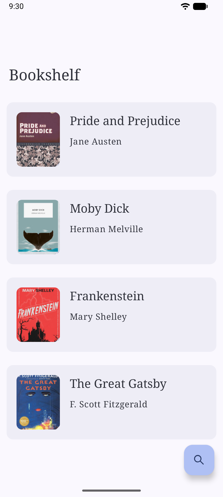
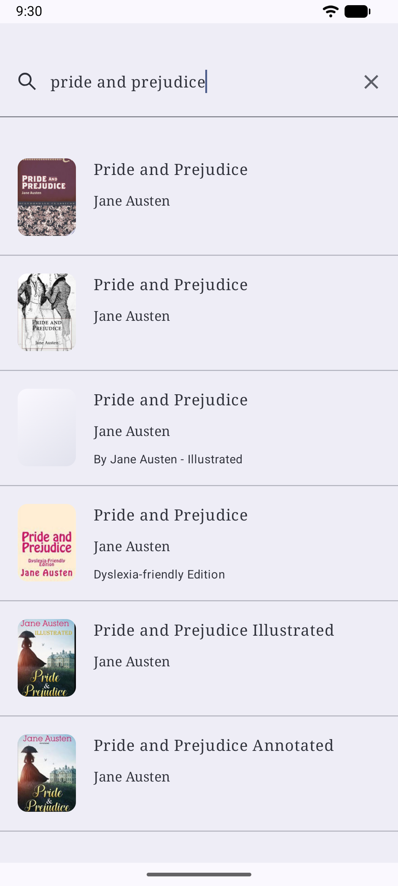
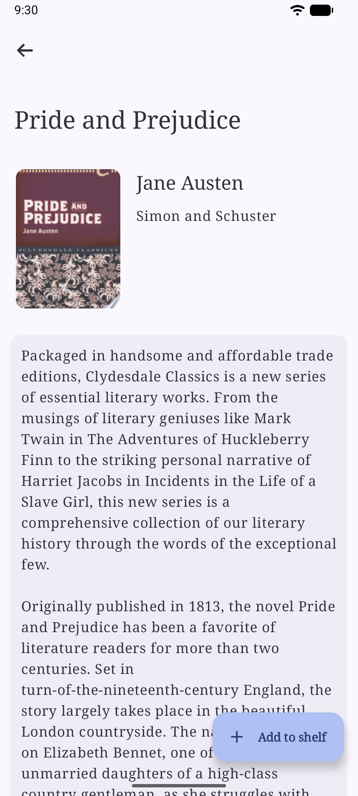
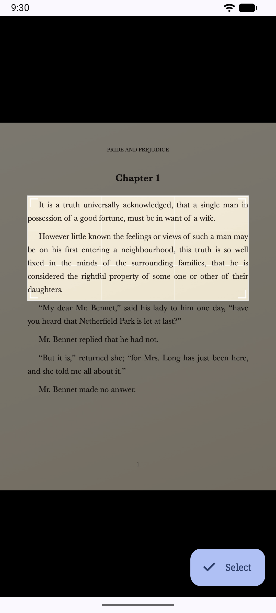
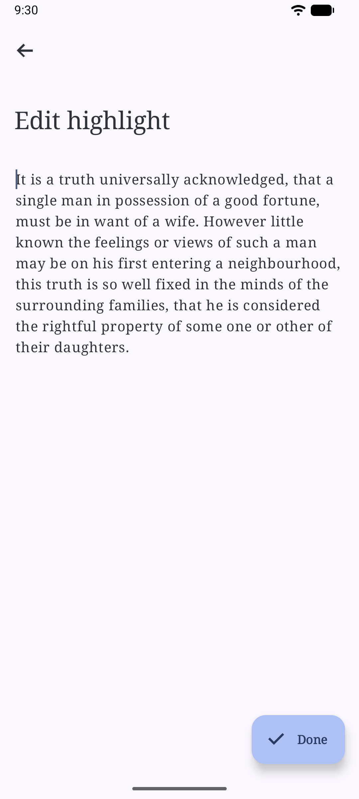
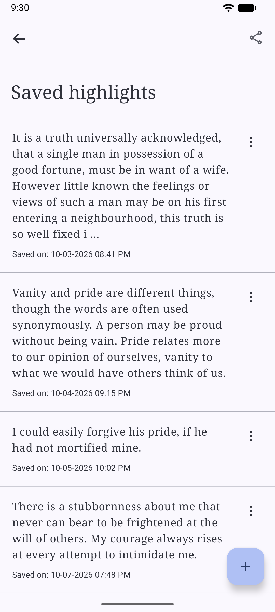
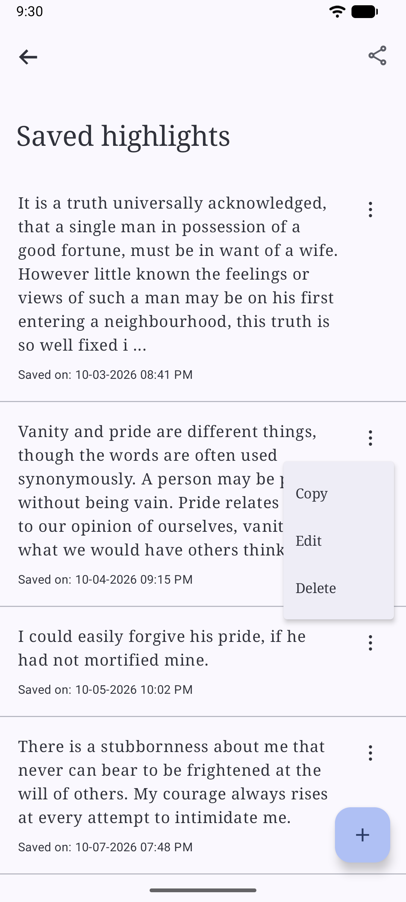
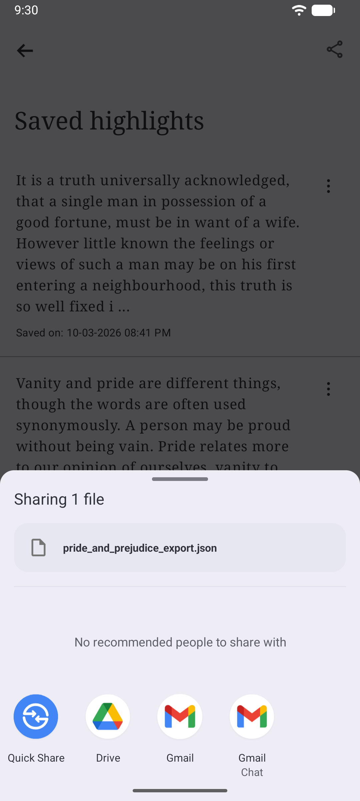
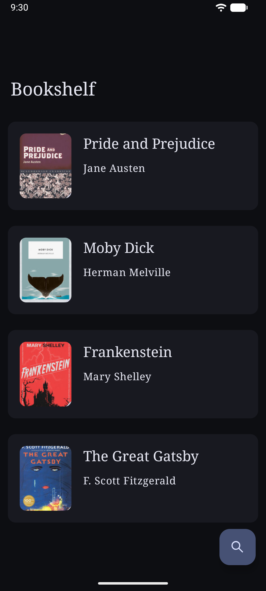
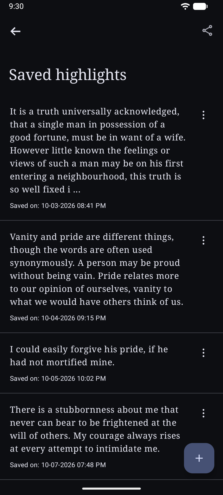

[](https://github.com/sriniketh/prose/actions/workflows/build.yml)

#  Prose

Prose is an Android app to capture and save highlights from physical books.

The app uses the [Google Books API](https://developers.google.com/books) to search for a book
and obtain rich content for the same. Books can be saved into a bookshelf and highlights can be
added for each saved book. Text recognition is performed
on-device using [ML Kit](https://developers.google.com/ml-kit/vision/text-recognition/android).

Saved books and highlights are persisted locally using Room for offline availability.

The app also
uses [DynamicColors API](https://developer.android.com/develop/ui/views/theming/dynamic-colors) to
align UI colors with the color theme of the wallpaper in both dark and light modes.

<table border="0">
  <tr>
    <td></td>
    <td></td>
    <td></td>
    <td></td>
    <td></td>
  </tr>
  <tr>
    <td></td>
    <td></td>
    <td></td>
    <td></td>
    <td></td>
  </tr>
</table>

## Building the project

### Requirements

- JDK 17 or newer to run Gradle (the JDK 17 toolchain the build compiles against is provisioned
  automatically)
- Android SDK with platform 37 installed
- A device or emulator running Android 8.0 (API 26) or newer, with Google Play services for
  on-device text recognition
- A [Google Books API key](https://developers.google.com/books/docs/v1/using#APIKey)

### Setup

Create `core-network/apikey.properties` with your key. Keep the quotes — the value is compiled into
the app as a string constant:

```properties
BOOKS_API_KEY="your-google-books-api-key"
```

Then build and test:

```bash
./gradlew assembleDebug
./gradlew test
```

## Architecture

Prose is a multi-module app. `core-*` modules cover networking (Retrofit + kotlinx.serialization),
persistence (Room), domain models, platform abstractions, and the Compose design system; each
`feature-*` module owns one area of the UI. Data flows one way — data sources → repositories →
ViewModels → Compose UI — with Hilt wiring everything together. Features depend only on the
`core-data:api` interfaces, while the implementations live in `core-data:impl`.

The [engineering docs](docs/README.md) cover the module graph, the UDF contract, and every user flow
in detail.

## License

```
    Copyright 2024 Sriniketh Ramachandran

    Licensed under the Apache License, Version 2.0 (the "License");
    you may not use this file except in compliance with the License.
    You may obtain a copy of the License at

        http://www.apache.org/licenses/LICENSE-2.0

    Unless required by applicable law or agreed to in writing, software
    distributed under the License is distributed on an "AS IS" BASIS,
    WITHOUT WARRANTIES OR CONDITIONS OF ANY KIND, either express or implied.
    See the License for the specific language governing permissions and
    limitations under the License.
```
